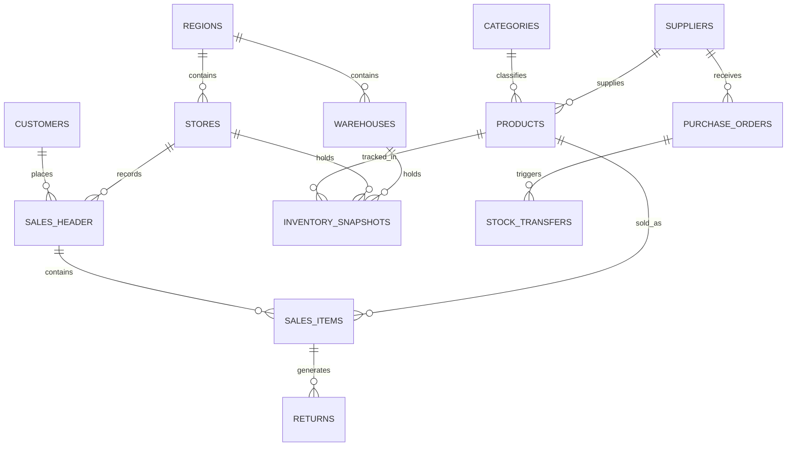

# 🛒 RetailIQ

### Retail Sales & Inventory Performance Analytics

<p align="center">

**An End-to-End Business Intelligence & Data Analytics Project for Apex Retail Corporation**

</p>

RetailIQ transforms retail sales, inventory, supplier, customer and store data into validated business intelligence using **PostgreSQL, SQL, Python and Power BI**.

> **Core principle:** Data must be cleaned, validated and reconciled before it is used for business insight or dashboard reporting.

<p align="center">


<br><br>


</p>

---

## 📑 Table of Contents

- [📌 Project Overview](#-project-overview)
- [🎯 Project Objectives](#-project-objectives)
- [👥 Stakeholders](#-stakeholders)
- [🗄️ Data Architecture](#️-data-architecture)
- [🔐 Data Integrity Rules](#-data-integrity-rules)
- [🧹 Data Quality & Cleaning](#-data-quality--cleaning)
- [📊 Core KPIs](#-core-kpis)
- [🧮 KPI Validation](#-kpi-validation)
- [🔬 Advanced Analytics](#-advanced-analytics)
- [📈 Power BI Dashboard](#-power-bi-dashboard)
- [🛠️ Technology Stack](#️-technology-stack)
- [📂 Repository Structure](#-repository-structure)
- [⚙️ Installation & Setup](#️-installation--setup)
- [📅 8-Week Project Plan](#-8-week-project-plan)
- [📦 Project Deliverables](#-project-deliverables)
- [🎓 Project Outcome](#-project-outcome)
- [👤 Author](#-author)

---

## 📌 Project Overview

**Apex Retail Corporation** is a simulated retail business operating across multiple regions, stores and warehouses.

| Business Area | Scope |
|---|---:|
| 🏪 **Retail Stores** | 25 |
| 🌍 **Regions** | 4 |
| 🏭 **Regional Warehouses** | 4 |
| 🏷️ **Active SKUs** | 1,200 |
| 🛒 **Sales Channels** | In-store & E-commerce |
| 📅 **Analysis Period** | Jan 2024 – Dec 2025 |

The business currently relies on delayed reporting, making it difficult to identify inventory problems, supplier issues, customer behaviour and store performance quickly.

### 🔎 RetailIQ provides one analytical view of:

- 💰 Sales and revenue performance
- 📈 Profitability and margins
- 📦 Inventory health
- ⚠️ Stock-outs and deadstock
- 🚚 Warehouse logistics
- 🤝 Supplier reliability
- 🏪 Store performance
- 👥 Customer behaviour
- 🏷️ Product and category performance

---

## 🎯 Project Objectives

RetailIQ directly supports six core business objectives:

| # | Objective | Description |
|:-:|---|---|
| 1️⃣ | **Inventory Visibility** | Identify healthy, low, excessive and slow-moving inventory |
| 2️⃣ | **Revenue & Margin Clarity** | Analyse revenue, costs and profitability across products, regions and channels |
| 3️⃣ | **Supplier Accountability** | Measure supplier reliability, lead time, delays and defects |
| 4️⃣ | **Customer Insights** | Understand customer value, purchasing behaviour and segments |
| 5️⃣ | **Executive Reporting** | Provide leadership with a clear interactive BI view |
| 6️⃣ | **Actionable Recommendations** | Convert validated analytical findings into practical business actions |

Every major KPI, query, visualization and recommendation is connected to one or more of these objectives.

---

## 👥 Stakeholders

| Stakeholder | Key Business Questions |
|---|---|
| 💼 **CEO / Finance** | How much revenue and margin are being generated? How much capital is tied up in inventory? |
| 📦 **Inventory Manager** | Where are stock-outs, excess stock and deadstock occurring? |
| 🤝 **Procurement Manager** | Which suppliers are reliable? Where are delays and defects occurring? |
| 📣 **Sales & Marketing** | Which channels, products and customer segments generate value? |
| ⚙️ **Operations Manager** | How are stores and regions performing? Where are stock transfers occurring? |

---

## 🗄️ Data Architecture

RetailIQ uses a **13-table relational database** covering sales, products, customers, inventory, suppliers, stores, warehouses, purchase orders and stock transfers.

### 🔗 Conceptual Data Map

```text
Categories ───────→ Products ←─────── Suppliers
                         │
                         ↓
Customers ───────→ Sales Header ─────→ Sales Items
                         │                  │
                         │                  ↓
                         │              Products
                         │
                         ↓
                      Returns

Warehouses / Stores ──→ Inventory Snapshots ←── Products

Suppliers ──→ Purchase Orders ──→ Stock Transfers
```

### 🧩 Entity Relationship Diagram



> **Schema note:** The physical SQL schema is the source of truth for table relationships. The ERD is maintained alongside `sql_scripts/01_schema_definition.sql`.

### 🗃️ Database Tables

| # | Table | Purpose |
|:-:|---|---|
| 1 | `regions` | Regional master data |
| 2 | `stores` | Retail outlet information |
| 3 | `warehouses` | Regional warehouse information |
| 4 | `categories` | Product category master |
| 5 | `suppliers` | Supplier master data |
| 6 | `products` | Product and SKU information |
| 7 | `customers` | Customer master data |
| 8 | `sales_header` | Order-level transaction information |
| 9 | `sales_items` | Product-level sales transactions |
| 10 | `returns` | Returned sales units |
| 11 | `inventory_snapshots` | Historical inventory levels |
| 12 | `purchase_orders` | Supplier purchase orders |
| 13 | `stock_transfers` | Stock movement between locations |

---

## 🔐 Data Integrity Rules

RetailIQ follows defined data integrity and governance rules:

- ✅ Primary keys are defined for relevant tables.
- ✅ Foreign-key relationships are enforced and referential integrity is checked.
- ✅ Returns are stored separately and are never represented as negative sales transactions.
- ✅ Raw data is preserved separately from processed data.
- ✅ Cleaning logic is maintained through reproducible SQL and Python scripts.
- ✅ Data-quality exceptions are documented.
- ✅ Analytical tables are generated only from validated data.

---

## 🧹 Data Quality & Cleaning

Data cleaning is treated as a major project deliverable. Raw files are never edited directly. Cleaning logic is maintained through version-controlled SQL scripts and Python analysis.

| Issue | Treatment |
|---|---|
| 🔁 **Duplicate records** | Identified using documented duplicate-detection rules |
| 👤 **Missing customers** | Mapped to a standard Guest Checkout record where appropriate |
| 💲 **Invalid prices** | Flagged and handled according to validation rules |
| 🔢 **Zero/invalid quantities** | Identified and investigated |
| 🏷️ **Invalid discounts** | Checked against business rules |
| 📅 **Date inconsistencies** | Standardised before time-based analysis |
| 🔗 **Orphan keys** | Identified and logged rather than silently removed |
| 📈 **Outliers** | Investigated to separate genuine transactions from data-entry issues |

---

## 📊 Core KPIs

Required KPIs are calculated through SQL/Python and cross-checked before being published in Power BI.

| KPI | Purpose |
|---|---|
| 💰 **Gross Revenue** | Measures sales revenue before applicable adjustments |
| 💵 **Net Revenue** | Measures sales revenue after applicable discounts and returns |
| 📈 **Gross Margin %** | Measures profitability after cost of goods sold |
| 🔄 **Inventory Turnover** | Measures how frequently inventory is sold and replaced |
| 📦 **Days of Inventory (DIO)** | Estimates how many days of inventory are held |
| ⚠️ **Stock-out Rate** | Measures inventory unavailability |
| 🚚 **Supplier OTIF %** | Measures on-time and in-full supplier delivery |
| 🧾 **Average Order Value (AOV)** | Measures average revenue per order |
| ↩️ **Return Rate %** | Measures returned units relative to sold units |

Detailed calculation logic is maintained in `sql_scripts/03_kpi_calculations.sql`.

---

## 🧮 KPI Validation

A major project requirement is consistency between analytical layers.

```text
Raw Data
   ↓
SQL Cleaning
   ↓
Processed Data
   ↓
SQL KPI Calculation
   ↓
Python Cross-Check
   ↓
Power BI Measures
   ↓
Final Validation
```

KPI results are compared between SQL, Python and Power BI. Any material mismatch is investigated before the metric is used in the final report or dashboard.

---

## 🔬 Advanced Analytics

RetailIQ goes beyond basic descriptive reporting by applying advanced analytical methods:

| Area | Techniques |
|---|---|
| 🧑‍🤝‍🧑 **Customer Analytics** | RFM analysis, customer segmentation, recency analysis, purchase frequency and monetary contribution |
| 📦 **Inventory Analytics** | Reorder Point (ROP), inventory velocity, deadstock identification, slow-moving inventory and inventory value |
| 🏷️ **Product Analytics** | Product contribution, category performance, margin contribution, product ranking and weak-margin products |
| 🛒 **Market Basket Analysis** | Product co-purchase analysis, product affinity and frequently purchased combinations |

---

## 📈 Power BI Dashboard

The project includes a **7-page interactive Power BI dashboard**.

| Page | Business Purpose |
|:---:|---|
| 1️⃣ **Executive Overview** | Overall business performance and headline KPIs |
| 2️⃣ **Sales & Revenue** | Revenue, margin, AOV, returns and channel performance |
| 3️⃣ **Inventory Health** | Stock levels, stock-outs, DIO, turnover and deadstock |
| 4️⃣ **Warehouse Logistics** | Warehouse inventory and stock transfer activity |
| 5️⃣ **Supplier Scorecard** | OTIF, lead time, delays and supplier quality |
| 6️⃣ **Store Performance** | Store revenue, productivity and regional performance |
| 7️⃣ **Product & Customer Analytics** | Product contribution, customer segments and purchasing behaviour |

> **Dashboard principle:** Every page should answer a business question, not simply display charts.

Dashboard screenshots are stored in `dashboards/screenshots/`.

---

## 🛠️ Technology Stack

| Technology | Purpose |
|---|---|
| 🐘 **PostgreSQL** | Relational database |
| 🗃️ **SQL** | Schema, cleaning, KPI calculations and business questions |
| 🐍 **Python** | Data quality, EDA and advanced analytics |
| 🐼 **Pandas / NumPy** | Data manipulation and numerical analysis |
| 📓 **Jupyter Notebook** | Reproducible Python analysis |
| 📊 **Power BI** | Interactive business intelligence dashboard |
| 🔧 **Git / GitHub** | Version control and documentation |

---

## 📂 Repository Structure

```text
RetailIQ-Analytics-Engine/
│
├── README.md
├── Data_Dictionary.md
├── requirements.txt
│
├── sql_scripts/
│   ├── 01_schema_definition.sql
│   ├── 02_data_cleaning.sql
│   ├── 03_kpi_calculations.sql
│   └── 04_business_questions.sql
│
├── python_notebooks/
│   ├── 00_generate_raw_data.py
│   ├── 01_data_quality_audit.py
│   ├── 02_exploratory_analysis.py
│   ├── 03_advanced_modeling.py
│   └── 04_data_ingestion_pipeline.py
│
├── dashboards/
│   ├── RetailIQ_Performance_Dashboard.pbix
│   └── screenshots/
│
├── data/
│   ├── raw/
│   └── processed/
│
└── executive_deliverables/
    ├── Business_Report.pdf
    └── Presentation.pdf
```

> **Note:** The repository structure above should match the actual files committed to GitHub. If a filename or deliverable differs in the repository, update this section accordingly.

---

## ⚙️ Installation & Setup

### 1️⃣ Clone the Repository

```bash
git clone <git clone https://github.com/YashodiChathurya/RetailIQ-Analytics-Engine.git
cd RetailIQ-Analytics-Engine>
cd RetailIQ-Analytics-Engine
```

### 2️⃣ Create the PostgreSQL Database

```sql
CREATE DATABASE "RetailIQ_DB";
```

### 3️⃣ Run the SQL Scripts

Run the database scripts in the following order:

```bash
psql -d RetailIQ_DB -f sql_scripts/01_schema_definition.sql
psql -d RetailIQ_DB -f sql_scripts/02_data_cleaning.sql
psql -d RetailIQ_DB -f sql_scripts/03_kpi_calculations.sql
psql -d RetailIQ_DB -f sql_scripts/04_business_questions.sql
```

### 4️⃣ Set Up the Python Environment

Install the required Python dependencies:

```bash
pip install -r requirements.txt
```

Generate the raw data:

```bash
python python_notebooks/00_generate_raw_data.py
```

Run the data ingestion pipeline:

```bash
python python_notebooks/04_data_ingestion_pipeline.py
```

Run the data quality audit:

```bash
python python_notebooks/01_data_quality_audit.py
```

Run exploratory analysis and advanced modelling as required:

```bash
python python_notebooks/02_exploratory_analysis.py
python python_notebooks/03_advanced_modeling.py
```

### 5️⃣ Open the Power BI Dashboard

Open:

```text
dashboards/RetailIQ_Performance_Dashboard.pbix
```

Then connect to the local `RetailIQ_DB` PostgreSQL database or the validated processed data, refresh the model, and verify the Power BI measures against the validated SQL/Python outputs.

---

## 📅 8-Week Project Plan

| Week | Focus | Main Output |
|:---:|---|---|
| 1 | Planning & Setup | Repository, ERD, data dictionary and project plan |
| 2 | Database & Audit | 13-table schema, data loading and quality audit |
| 3 | Data Cleaning | Cleaning scripts, processed data and audit trail |
| 4 | Core Analysis | KPIs and business-question outputs |
| 5 | Advanced Analytics | RFM, ROP, deadstock and market basket analysis |
| 6 | Dashboard | Seven-page Power BI dashboard |
| 7 | Reporting | Executive report and presentation |
| 8 | Finalisation | Validation, demonstration and submission package |

---

## 📦 Project Deliverables

| Deliverable | Contents |
|---|---|
| 🗂️ **Architecture & Data Dictionary** | ERD, table definitions, relationships, data flow and metric glossary |
| 🗃️ **SQL Scripts** | Schema, cleaning, KPI calculations and business-question queries |
| 📓 **Python Analysis** | Data audit, EDA, RFM, ROP, deadstock and market basket analysis |
| 📊 **Power BI Dashboard** | Seven-page interactive BI dashboard and screenshots |
| 📄 **Business Report** | Executive insights and evidence-based recommendations |
| 🖥️ **Presentation** | Ten-slide final project presentation |

---

## 🎓 Project Outcome

RetailIQ establishes a structured analytical workflow that connects:

```text
Raw Data
   ↓
Data Quality
   ↓
SQL Transformation
   ↓
KPI Validation
   ↓
Advanced Analytics
   ↓
Power BI
   ↓
Business Recommendations
```

The project demonstrates how retail data can be transformed into a reliable decision-support system through:

- ✅ Structured relational data modelling
- ✅ Reproducible data cleaning
- ✅ SQL-based KPI development
- ✅ Python-based analytical validation
- ✅ Advanced retail analytics
- ✅ Interactive Power BI reporting
- ✅ Evidence-based business recommendations

---

## 👤 Author

<p align="center">

### **Yashodi Chathurya Abeysundara**

**Data Analyst**

Apex Retail Corporation — RetailIQ Project

<br>

⭐ *If you found this project useful, consider giving it a star!*

</p>

---

<p align="center">

**RetailIQ — Turning Retail Data into Business Intelligence.**

</p>
