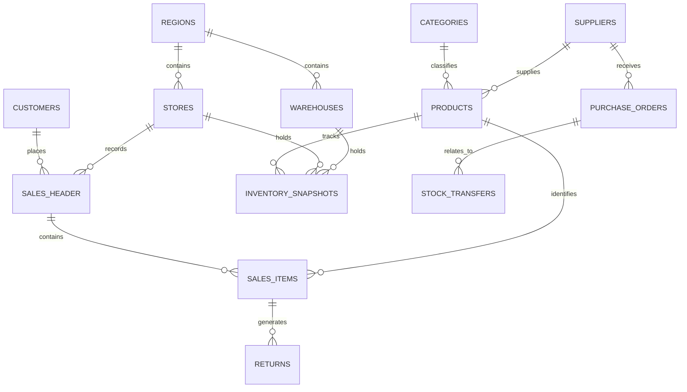

# 🛒 RetailIQ — Retail Sales & Inventory Performance Analytics

<p align="center">

**An End-to-End Business Intelligence & Data Analytics Project for Apex Retail Corporation**

</p>

RetailIQ transforms retail sales, inventory, supplier, customer and store data into validated business intelligence using **PostgreSQL, SQL, Python and Power BI**.

> **Core principle:** Data must be cleaned, validated and reconciled before it is used for business insight or dashboard reporting.

<p align="center">
  
  
  
  
  
</p>

<p align="center">
  
  
  
  
</p>

---

## 📑 Table of Contents

- [📌 Project Overview](#-project-overview)
- [🏢 Business Scenario](#-business-scenario)
- [🎯 Business Problem](#-business-problem)
- [🚀 Project Objectives](#-project-objectives)
- [👥 Stakeholders](#-stakeholders)
- [📦 Project Scope](#-project-scope)
- [🗄️ Data Architecture](#️-data-architecture)
- [🧹 Data Quality & Cleaning](#-data-quality--cleaning)
- [📊 Core Business KPIs](#-core-business-kpis)
- [🔎 Business Analysis](#-business-analysis)
- [🧠 Advanced Analytics](#-advanced-analytics)
- [📈 Power BI Dashboard](#-power-bi-dashboard)
- [🛠️ Technology Stack](#️-technology-stack)
- [📂 Repository Structure](#-repository-structure)
- [⚙️ Installation & Setup](#️-installation--setup)
- [📅 Eight-Week Project Plan](#-eight-week-project-plan)
- [📦 Project Deliverables](#-project-deliverables)
- [✅ Validation Checklist](#-validation-checklist)
- [⚠️ Limitations](#️-limitations)
- [👤 Author](#-author)

---

## 📌 Project Overview

**RetailIQ** is an end-to-end Business Intelligence and Data Analytics project developed for the simulated retail business **Apex Retail Corporation** as part of the Codezela Career Accelerator (CCA) Data Analyst Internship.

The project transforms raw retail data into reliable, validated, and actionable business intelligence using SQL, Python, and Power BI.

By integrating sales, inventory, suppliers, stores, warehouses, products, and customer information, RetailIQ aims to help business stakeholders understand performance, identify operational risks, and make evidence-based decisions.

### 🔑 Core Principle

> **Data must be cleaned, validated, and reconciled before it is used for business insights or dashboard reporting.**

### 🔄 End-to-End Analytics Workflow

```text
Raw Data
   ↓
Database Design & Data Ingestion
   ↓
Data Quality Audit
   ↓
SQL Data Cleaning & Transformation
   ↓
KPI Calculation & Validation
   ↓
Exploratory Data Analysis
   ↓
Advanced Analytics
   ↓
Interactive Power BI Dashboard
   ↓
Executive Insights & Recommendations
```

---

## 🏢 Business Scenario

Apex Retail Corporation is a simulated retail organisation operating across multiple regions, with physical retail stores and an e-commerce sales channel.

| Business Attribute | Project Scope |
|---|---|
| 🏪 Retail Outlets | 25 |
| 🌍 Regions | East, Midwest, South, West |
| 🏭 Regional Warehouses | 4 |
| 🏷️ Active Product SKUs | 1,200 |
| 🛒 Sales Channels | In-store & E-commerce |
| 📅 Analysis Period | January 2024 – December 2025 |
| 🗄️ Relational Database | 13 Related Tables |

*The figures above describe the project scenario, not verified analytical results.*

---

## 🎯 Business Problem

Apex Retail faces several challenges that can affect profitability, inventory availability, and operational efficiency.

- ⚠️ Stock-outs in some locations while excess inventory remains elsewhere.
- 📦 Slow-moving products tying up working capital.
- 🚚 Limited visibility into supplier delivery delays and incomplete orders.
- 📉 Inconsistent reporting across business functions.
- 🏪 Difficulty comparing store and regional performance.
- 👥 Limited understanding of customer purchasing patterns and product relationships.
- ⏳ Delays in turning operational data into useful business insights.

### 💡 RetailIQ Solution

RetailIQ provides a structured analytical framework that connects validated data with meaningful KPIs, interactive visualisations, and evidence-based recommendations.

The objective is to help decision-makers understand **what is happening, where it is happening, why it may be happening, and what action should be considered next.**

---

## 🚀 Project Objectives

| # | Objective | Expected Business Value |
|---|---|---|
| 1 | 📦 Inventory Visibility | Identify low stock, stock-outs, excess inventory, and slow-moving products |
| 2 | 💰 Revenue & Profitability | Analyse revenue, costs, margins, and returns |
| 3 | 🚚 Supplier Accountability | Evaluate delivery reliability, lead times, and defects where data is available |
| 4 | 👥 Customer Intelligence | Understand customer value, purchase frequency, and buying behaviour |
| 5 | 📊 Executive Reporting | Deliver a consistent, interactive business performance view |
| 6 | 🎯 Actionable Recommendations | Translate validated findings into practical business actions |

---

## 👥 Stakeholders

| Stakeholder | Key Business Questions |
|---|---|
| 💼 CEO / Finance | How much revenue and gross profit are generated? How much capital is tied up in inventory? |
| 📦 Inventory Manager | Which products are at risk of stock-outs or excess inventory? |
| 🤝 Procurement Manager | Which suppliers deliver reliably and which require attention? |
| 📣 Sales & Marketing | Which products, channels, and customer segments contribute the most value? |
| ⚙️ Operations Manager | Which stores and regions perform well, and where are operational improvements needed? |

---

## 📦 Project Scope

### ✅ Included

- Design and implement a relational database containing 13 related tables.
- Preserve raw data and document data quality issues.
- Clean, validate, and transform data using SQL and Python.
- Calculate and reconcile core business KPIs.
- Conduct exploratory data analysis (EDA).
- Perform customer, inventory, product, and market basket analysis where supported by the data.
- Answer business questions through documented SQL queries.
- Develop a seven-page interactive Power BI or Tableau dashboard.
- Prepare an executive business report and a 10-slide presentation.
- Maintain version-controlled code, documentation, and weekly progress evidence.

### 🚫 Outside Scope

- Access to real company systems or live ERP integration.
- Building a full production web application.
- Presenting unverified calculations as business results.
- Making unsupported claims about business impact.

---

## 🗄️ Data Architecture

RetailIQ uses a relational data model covering sales transactions, customers, products, inventory, suppliers, stores, warehouses, returns, purchase orders, and stock transfers.

### 🔗 Conceptual Data Relationships

```text
Regions ────────────┬──────────── Stores
                    └──────────── Warehouses

Categories ───────────────────── Products
Suppliers ────────────────────── Products

Customers ────────────────────── Sales Header
Stores ───────────────────────── Sales Header
Sales Header ─────────────────── Sales Items
Products ─────────────────────── Sales Items
Sales Items ──────────────────── Returns

Products ─────────────────────── Inventory Snapshots
Stores ───────────────────────── Inventory Snapshots
Warehouses ───────────────────── Inventory Snapshots

Suppliers ────────────────────── Purchase Orders
Purchase Orders ──────────────── Stock Transfers
```

### 🧩 Entity Relationship Diagram



*The diagram is conceptual. The implemented SQL schema is the source of truth for the actual foreign keys and relationship cardinalities.*

### 🗃️ Database Tables

| # | Table | Purpose |
|---:|---|---|
| 1 | `regions` | Regional master data |
| 2 | `stores` | Retail outlet information |
| 3 | `warehouses` | Warehouse information |
| 4 | `categories` | Product category classification |
| 5 | `suppliers` | Supplier master data |
| 6 | `products` | Product and SKU information |
| 7 | `customers` | Customer master data |
| 8 | `sales_header` | Order-level transaction details |
| 9 | `sales_items` | Product-level sales transactions |
| 10 | `returns` | Returned sales units and records |
| 11 | `inventory_snapshots` | Historical inventory quantities |
| 12 | `purchase_orders` | Supplier purchasing activity |
| 13 | `stock_transfers` | Stock movement records |

### 🔐 Database Integrity Requirements

- Enforce primary keys and foreign keys.
- Apply appropriate constraints and data types.
- Keep sales headers separate from sales line items.
- Store returns as separate records rather than automatically treating them as negative sales.
- Preserve source files and maintain traceable transformations.
- Validate row counts and referential integrity after loading and cleaning.

---

## 🧹 Data Quality & Cleaning

Data quality is a central part of RetailIQ. Raw source data must remain unchanged while cleaning rules are applied reproducibly.

| Data Quality Issue | Treatment |
|---|---|
| 🔁 Duplicate records | Detect using documented business keys and investigate |
| 👤 Missing customers | Use a Guest Checkout mapping only where appropriate |
| 💲 Invalid prices | Flag and investigate according to business rules |
| 🔢 Invalid quantities | Identify zero, negative, or otherwise invalid values |
| 🏷️ Discount anomalies | Validate discount ranges and transaction logic |
| 📅 Date inconsistencies | Standardise formats and validate reporting periods |
| 🔗 Orphan foreign keys | Log records referencing missing entities |
| 📈 Outliers | Investigate unusual values before correction or exclusion |
| 📦 Inventory inconsistencies | Check duplicate snapshots and product-location combinations |

### Recommended Data Quality Workflow

1. Preserve original source files.
2. Profile each table and record initial row counts.
3. Check missing values, duplicates, invalid values, outliers, and orphan keys.
4. Document cleaning rules and assumptions.
5. Apply repeatable transformations using SQL and Python.
6. Store processed data separately from raw data.
7. Log rejected rows and material corrections.
8. Compare before-and-after counts and validate relationships.
9. Approve the cleaned data before KPI calculation.

---

## 📊 Core Business KPIs

RetailIQ calculates its required KPIs using documented definitions and reconciles results across SQL, Python, and Power BI where applicable.

| KPI | Calculation Principle | Business Purpose |
|---|---|---|
| 💰 Gross Revenue | Sales value before applicable discounts and returns | Understand sales generated |
| 💵 Net Revenue | Revenue after applicable discounts and returns | Measure realised sales revenue |
| 📈 Gross Margin % | Gross profit ÷ net revenue × 100 | Evaluate profitability |
| 🔄 Inventory Turnover | Cost of goods sold ÷ average inventory at cost | Measure inventory efficiency |
| 📦 Days of Inventory (DIO) | Average inventory at cost ÷ COGS × period days | Estimate inventory coverage |
| ⚠️ Stock-out Rate | Eligible stock-out events ÷ eligible observations × 100 | Measure availability problems |
| 🚚 Supplier OTIF % | On-time and in-full eligible deliveries ÷ eligible deliveries × 100 | Measure supplier reliability |
| 🧾 Average Order Value | Eligible order revenue ÷ eligible order count | Measure average order value |
| ↩️ Return Rate % | Returned units ÷ eligible units sold × 100 | Monitor returns |

### 🧮 KPI Formula Reference

```text
Gross Profit = Net Revenue - Cost of Goods Sold

Gross Margin % = (Gross Profit / Net Revenue) × 100

AOV = Eligible Order Revenue / Eligible Order Count

Inventory Turnover =
    Cost of Goods Sold / Average Inventory at Cost

DIO =
    (Average Inventory at Cost / Cost of Goods Sold)
    × Number of Days in the Period

Supplier OTIF % =
    (On-Time and In-Full Eligible Deliveries
    / Total Eligible Deliveries) × 100

Return Rate % =
    (Returned Units / Eligible Units Sold) × 100
```

**Important:** These are calculation principles, not precomputed results. The final implementation must document the treatment of discounts, returns, cancellations, missing values, and zero denominators. The inventory and supplier measures also require suitable historical inventory and delivery data.

### 🔍 KPI Validation Pipeline

```text
Raw Data
   ↓
Validated Database
   ↓
SQL Transformations
   ↓
SQL KPI Results
   ↓
Python Cross-Checks
   ↓
Power BI Measures
   ↓
Final Reconciliation
```

A material discrepancy must be investigated before the affected metric is used in reporting.

---

## 🔎 Business Analysis

The project organises its analytical questions into six areas.

### 1. 💰 Sales Performance

- How does revenue change over time?
- Which channels, regions, and stores contribute to sales?
- Which products and categories generate the highest revenue?
- How do discounts and returns affect reported performance?

### 2. 📦 Inventory Health

- Which product-location combinations are out of stock?
- Which products have low or excessive inventory?
- Which items show low movement over the selected analysis period?
- Where are reorder recommendations appropriate?

### 3. 🚚 Supplier Performance

- Which suppliers meet on-time and in-full delivery expectations?
- How long do suppliers take to deliver?
- Where are delays, incomplete deliveries, or defects occurring?

### 4. 🏪 Store & Warehouse Operations

- Which stores generate the most revenue?
- How does store performance differ by region?
- How is inventory distributed across warehouses and stores?
- What stock-transfer patterns can be identified?

### 5. 👥 Customer & Product Intelligence

- Which customer segments contribute the most monetary value?
- Which customers make repeat purchases?
- Which products contribute the most gross profit where cost data is available?
- Which products are frequently purchased together?

### 6. 📊 Executive Decision Support

- How are revenue, margin, and inventory changing?
- Which operational issues deserve attention first?
- What practical actions are supported by the analytical findings?

Every query should answer a defined business question and include a short explanation of its result, business significance, and data limitations.

---

## 🧠 Advanced Analytics

### 👥 RFM Customer Segmentation

RFM analysis segments customers using:

- **Recency:** Time since the customer's most recent eligible purchase.
- **Frequency:** Number of eligible purchases during the analysis period.
- **Monetary Value:** Total eligible purchase value.

The analysis defines its reference date, order eligibility, scoring method, and treatment of missing customer identities. Segment results can support targeted customer engagement strategies.

### 📦 Reorder Point Analysis

Reorder point analysis estimates when replenishment should be considered.

```text
Reorder Point =
    Expected Demand During Lead Time + Safety Stock
```

The approach should account for demand patterns, supplier lead times, inventory available, and outstanding purchase orders where these fields exist.

### ⚠️ Slow-Moving Inventory & Deadstock

Evaluate:

- Last sale date.
- Days since the last sale.
- Units sold during a defined period.
- Current inventory quantity and value.
- Product movement and inventory age where available.

Thresholds must be documented. A product with no recent sales should be investigated rather than automatically classified as obsolete.

### 🛒 Market Basket Analysis

Use transaction-level sales data to identify products that are frequently purchased together.

Key measures include:

- **Support:** Frequency of an item combination across transactions.
- **Confidence:** Frequency of a combination relative to transactions containing the first item.
- **Lift:** Strength of the association compared with independent purchasing.

The results may inform product bundling, cross-selling, and product placement.

### 🏷️ Product Profitability

Where reliable cost data is available, compare revenue, cost of goods sold, gross profit, margin, discounts, returns, and inventory investment.

Revenue alone does not establish product profitability.

---

## 📈 Power BI Dashboard

RetailIQ is planned as a **seven-page interactive business intelligence dashboard**. Each page focuses on a specific business question.

| Page | Dashboard Section | Key Visuals & Metrics |
|---:|---|---|
| 1 | Executive Overview | Revenue, orders, AOV, margin, inventory value, supplier OTIF, regional trends |
| 2 | Sales & Revenue | Revenue trends, product rankings, category performance, channel comparisons, returns |
| 3 | Inventory Health | Stock status, inventory value, turnover, DIO, low-stock products, reorder alerts |
| 4 | Warehouse Logistics | Inventory distribution, warehouse comparisons, transfers, product availability |
| 5 | Supplier Scorecard | OTIF, lead time, purchasing volume, delays, defects where supported |
| 6 | Store Performance | Store rankings, regional performance, monthly trends, sales per store |
| 7 | Product & Customer Analytics | RFM segments, repeat purchasing, product profitability, market basket analysis |

### 🎨 Dashboard Design Principles

- Use consistent KPI definitions and number formats.
- Include relevant date, region, channel, store, and category filters.
- Give each visual a clear title and readable labels.
- Avoid misleading axes and unnecessary visual complexity.
- Display the reporting period and relevant metric definitions.
- Reconcile Power BI measures against validated analytical results.
- Clearly identify metrics that cannot be reliably calculated from the available data.
- Save screenshots of all seven pages in `dashboards/screenshots/`.

### 🖼️ Dashboard Preview

### 1. Executive Overview


---

### 2. Sales & Revenue


---

### 3. Inventory Health


---

### 4. Warehouse Logistics


---

### 5. Supplier Scorecard


---

### 6. Store Performance


---

### 7. Customer Analytics

---

## 🛠️ Technology Stack

| Technology | Purpose |
|---|---|
| 🐘 PostgreSQL | Relational database and integrity constraints |
| 🗃️ SQL | Data transformations, joins, CTEs, window functions, KPIs |
| 🐍 Python | Data auditing, EDA, validation, and advanced analysis |
| 🐼 Pandas & NumPy | Data manipulation and numerical analysis |
| 📓 Jupyter Notebook | Reproducible analytical workflows |
| 📊 Power BI / Tableau | Interactive dashboards and reporting |
| 📈 Matplotlib / Seaborn | Exploratory visualisations where used |
| 🔧 Git & GitHub | Version control and project documentation |
| 📝 Markdown / PDF Tools | Data dictionary, business report, and presentation |

The final repository should document the tools actually used in the implementation.

---

## 📂 Repository Structure

```text
RetailIQ-Analytics-Engine/
│
├── README.md
├── Data_Dictionary.md
│
├── sql_scripts/
│   ├── 01_schema_definition.sql
│   ├── 02_data_cleaning.sql
│   ├── 03_kpi_calculations.sql
│   └── 04_business_questions.sql
│
├── python_notebooks/
│   ├── 01_data_quality_audit.ipynb
│   ├── 02_exploratory_analysis.ipynb
│   └── 03_advanced_modeling.ipynb
│
├── dashboards/
│   ├── RetailIQ_Performance_Dashboard.pbix
│   └── screenshots/
│
├── data/
│   ├── raw/
│   └── processed/
│
└── executive_deliverables/
    ├── Business_Report.pdf
    └── Presentation.pdf
```

**Repository note:** This is the target structure. Update it to match the files actually committed to GitHub. Include additional scripts, configuration files, or outputs only when they exist and are maintained.

### 🔧 Repository Best Practices

- Preserve raw source data.
- Never commit passwords, database credentials, or other secrets.
- Follow internship rules before publishing source datasets.
- Avoid committing large generated datasets unless required and permitted.
- Provide actual `.ipynb` files when notebooks are required.
- Keep documentation paths consistent with repository filenames.
- Commit work regularly to demonstrate individual progress.

---

## ⚙️ Installation & Setup

### 1. Clone the Repository

Replace the example URL with the actual GitHub repository URL.

```bash
git clone <YOUR_GITHUB_REPOSITORY_URL>
cd RetailIQ-Analytics-Engine
```

### 2. Create the Database

For a PostgreSQL implementation:

```sql
CREATE DATABASE retailiq_db;
```

Connect to the new database using PostgreSQL or an appropriate database client.

### 3. Create the Database Schema

If the schema file exists and is compatible with PostgreSQL:

```bash
psql -d retailiq_db -f sql_scripts/01_schema_definition.sql
```

Verify the tables, keys, constraints, and relationships before loading data.

### 4. Load and Clean the Data

Use the dataset supplied for the internship or the documented simulated dataset. Follow the actual ingestion process and verify the source columns against the database schema.

For the target SQL script structure:

```bash
psql -d retailiq_db -f sql_scripts/02_data_cleaning.sql
psql -d retailiq_db -f sql_scripts/03_kpi_calculations.sql
psql -d retailiq_db -f sql_scripts/04_business_questions.sql
```

Run scripts only after satisfying their prerequisites. Some cleaning and KPI scripts may require data-loading steps or database objects that must be created first.

### 5. Set Up the Python Environment

Create a virtual environment on Windows:

```bash
python -m venv .venv
.venv\Scripts\activate
```

Install dependencies if a maintained `requirements.txt` exists:

```bash
python -m pip install -r requirements.txt
```

Open the project's actual Jupyter notebooks and execute them in the documented order.

### 6. Open the BI Dashboard

Open the implemented Power BI `.pbix` or Tableau workbook.

1. Configure the correct data source.
2. Refresh the data model.
3. Verify relationships and measures.
4. Compare dashboard results with validated SQL and Python outputs.
5. Save screenshots of the seven completed dashboard pages.

**Note:** Commands and filenames must be adjusted to match the actual implementation.

---

## 📅 Eight-Week Project Plan

| Week | Focus | Expected Evidence |
|---:|---|---|
| 1 | Planning & Setup | Repository, ERD draft, data dictionary, project plan |
| 2 | Database & Audit | 13-table schema, loading evidence, row counts, quality audit |
| 3 | Data Cleaning | Cleaning scripts, processed data, exception logs |
| 4 | Core Analysis | KPI calculations, SQL queries, validation notes |
| 5 | Advanced Analytics | RFM, reorder point, deadstock, basket analysis where supported |
| 6 | Dashboard Development | Seven-page BI dashboard and screenshots |
| 7 | Business Reporting | Executive report, recommendation table, 10-slide presentation |
| 8 | Finalisation | Final validation, demonstration, and submission package |

### 📝 Weekly Progress Evidence

Each weekly update should include:

- Work completed.
- Evidence produced.
- Tasks in progress.
- Blockers and risks.
- Decisions required from the mentor.
- Individual contribution.
- Next week's plan.

Evidence may include GitHub commits, SQL outputs, notebook results, dashboard screenshots, and report drafts.

---

## 📦 Project Deliverables

| Deliverable | Expected Contents |
|---|---|
| 🗄️ Architecture & Data Dictionary | ERD, 13-table definitions, relationships, data flow, KPI glossary |
| 💻 SQL Scripts | Schema, cleaning, KPI calculations, business-question queries |
| 📓 Python Notebooks | Data quality audit, EDA, RFM, inventory and market basket analysis where supported |
| 📊 BI Dashboard | Seven-page interactive report and screenshots |
| 📄 Executive Business Report | Methodology, validated insights, recommendations, evidence, limitations |
| 🖥️ Final Presentation | Ten-slide project presentation PDF |
| 📈 Project Evidence | Weekly updates, version history, validation results, final demonstration materials |

### 🎓 Assessment Weighting

| Assessment Area | Weight |
|---|---:|
| SQL, Python & Data Cleaning | 30% |
| EDA, KPIs & Advanced Analytics | 25% |
| Dashboard Quality & Usability | 15% |
| Business Recommendations | 15% |
| Documentation & Presentation | 15% |
| **Total** | **100%** |

The project should be reproducible and explainable. Every important calculation should be supported by documented logic and evidence.

---

## ✅ Validation Checklist

- [ ] The 13-table database is implemented and row counts are verified.
- [ ] Primary keys, foreign keys, and constraints are checked.
- [ ] Raw source data remains unchanged.
- [ ] Duplicate, null, invalid-value, date, outlier, and orphan-key checks are documented.
- [ ] Cleaning decisions and rejected records are traceable.
- [ ] Core KPIs are calculated using documented definitions.
- [ ] SQL and Python results are reconciled.
- [ ] Business questions are answered using organised queries.
- [ ] Python notebooks run and explain the analysis.
- [ ] Advanced analysis is completed where supported by the data.
- [ ] All seven dashboard pages are implemented and validated.
- [ ] Dashboard screenshots are saved.
- [ ] The executive report and 10-slide presentation are finalised.
- [ ] Repository paths and filenames match the actual files.
- [ ] Weekly progress evidence is available.
- [ ] The final package follows the official internship submission instructions.

---

## ⚠️ Limitations & Assumptions

- Apex Retail Corporation is a simulated business scenario, not a claim about a real company's operations.
- Final analytical findings depend on the supplied or simulated dataset and its quality.
- No KPI values should be presented as verified results until they have been calculated and validated.
- Metrics such as customer lifetime value, supplier defect rate, inventory age, and cash-to-cash cycle require appropriate supporting data.
- Historical inventory, purchase order, and delivery data must be sufficient for reliable inventory and supplier analysis.
- Recommendations are proposals; their actual business impact requires subsequent measurement.
- Data publication and submission must follow the internship's rules.

---

## 👨‍💻 Author

<p align="center">

### **Yashodi Chathurya Abeysundara**
**Data Analyst**  
Apex Retail Corporation — RetailIQ Project  

<br>

⭐ *If you found this project useful, consider giving it a star!*

</p>

---

<p align="center">

**RetailIQ — Turning Retail Data into Business Intelligence.**

</p>