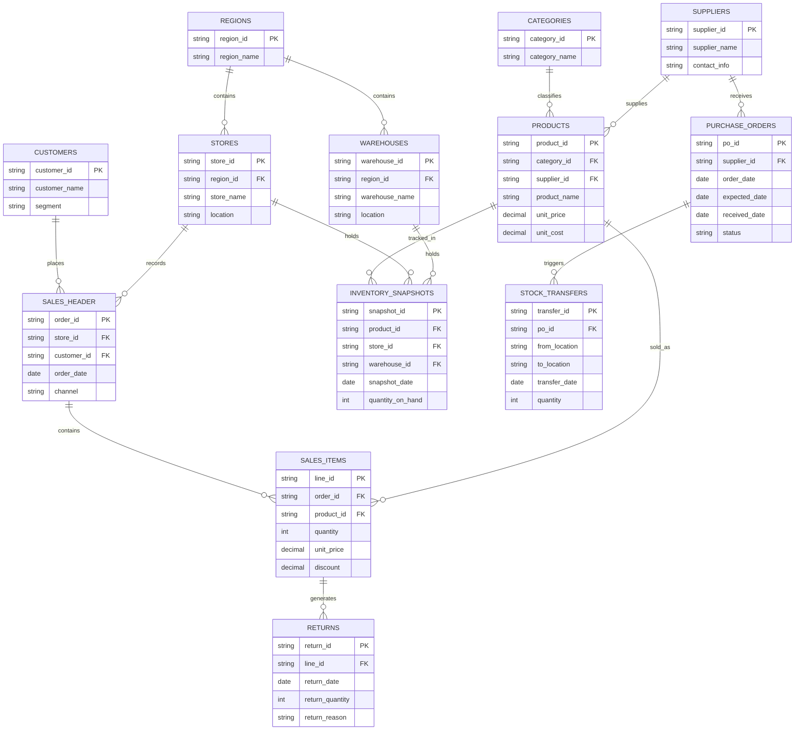

<div align="center">

# 🛒 RetailIQ
### Retail Sales & Inventory Performance Analytics

**An end-to-end Business Intelligence & Data Analytics project for Apex Retail Corporation**


RetailIQ transforms raw retail sales, inventory, supplier, customer and store data into reliable business intelligence using **PostgreSQL**, **SQL**, **Python** and **Power BI**.

</div>

<p align="center">
<code>Raw Data</code> → <code>Data Quality</code> → <code>Cleaning</code> → <code>KPI Calculation</code> → <code>Validation</code> → <code>Advanced Analytics</code> → <code>Dashboard</code> → <code>Business Recommendations</code>
</p>

---

## 📑 Table of Contents
- [📌 Project Overview](#-project-overview)
- [🎯 Project Objectives](#-project-objectives)
- [👥 Stakeholders](#-stakeholders)
- [🗄️ Data Architecture](#️-data-architecture)
- [🔐 Data Integrity Rules](#-data-integrity-rules)
- [🧹 Data Quality & Cleaning](#-data-quality--cleaning)
- [📊 Core KPIs](#-core-kpis)
- [🧮 KPI Validation](#-kpi-validation)
- [🔬 Advanced Analytics](#-advanced-analytics)
- [📈 Power BI Dashboard](#-power-bi-dashboard)
- [🛠️ Technology Stack](#️-technology-stack)
- [📂 Repository Structure](#-repository-structure)
- [⚙️ Installation & Setup](#️-installation--setup)
- [📅 8-Week Project Plan](#-8-week-project-plan)
- [📦 Project Deliverables](#-project-deliverables)
- [👤 Author](#-author-info)

---

## 📌 Project Overview

Apex Retail Corporation is a simulated retail business operating across multiple regions, stores and warehouses.


| Business Area | Scope |
| :---: | :---: |
| **Retail Stores** | 25 |
| **Regions** | 4 |
| **Regional Warehouses** | 4 |
| **Active SKUs** | 1,200 |
| **Sales Channels** | In-store & E-commerce |
| **Analysis Period** | Jan 2024 – Dec 2025 |


The business currently relies on delayed reporting, making it difficult to identify inventory problems, supplier issues, customer behaviour and store performance quickly.

**RetailIQ provides one analytical view of:**

✔️ Sales and revenue performance &nbsp;&nbsp; ✔️ Profitability and margins &nbsp;&nbsp; ✔️ Inventory health
✔️ Stock-outs and deadstock &nbsp;&nbsp; ✔️ Warehouse logistics &nbsp;&nbsp; ✔️ Supplier reliability
✔️ Store performance &nbsp;&nbsp; ✔️ Customer behaviour &nbsp;&nbsp; ✔️ Product & category performance

> 💡 **Core principle:** Data must be cleaned and validated before it is used for business insight or dashboard reporting.

---

## 🎯 Project Objectives

The project directly supports the six objectives defined in the CCA project brief.

| # | Objective | Description |
| :---: | :--- | :--- |
| 1️⃣ | **Inventory Visibility** | Identify healthy, low, excessive and slow-moving inventory |
| 2️⃣ | **Revenue & Margin Clarity** | Analyse revenue, costs and profitability across products, regions and channels |
| 3️⃣ | **Supplier Accountability** | Measure supplier reliability, lead time, delays and defects |
| 4️⃣ | **Customer Insights** | Understand customer value, purchasing behaviour and segments |
| 5️⃣ | **Executive Reporting** | Provide leadership with a clear interactive BI view |
| 6️⃣ | **Actionable Recommendations** | Convert validated analytical findings into practical business actions |

> Every major KPI, query, visualization and recommendation is connected to one or more of these objectives.

---

## 👥 Stakeholders

| Stakeholder | Key Business Questions |
| :--- | :--- |
| 💼 **CEO / Finance** | How much revenue and margin are being generated? How much capital is tied up in inventory? |
| 📦 **Inventory Manager** | Where are stock-outs, excess stock and deadstock occurring? |
| 🤝 **Procurement Manager** | Which suppliers are reliable? Where are delays and defects occurring? |
| 📣 **Sales & Marketing** | Which channels, products and customer segments generate value? |
| ⚙️ **Operations Manager** | How are stores and regions performing? Where are stock transfers occurring? |

---

## 🗄️ Data Architecture

RetailIQ uses a **13-table relational database** covering sales, products, customers, inventory, suppliers, stores, warehouses, purchase orders and stock transfers.

**Conceptual Data Map**
```
Categories → Products ← Suppliers
Customers → Sales Header → Sales Items ← Products
Warehouses / Stores → Inventory Snapshots ← Products
Suppliers → Purchase Orders → Stock Transfers
```

### 🧩 Entity Relationship Diagram



> 🗒️ **Schema Note:** The physical SQL schema is the source of truth for table relationships. The ERD remains synchronized with `sql_scripts/01_schema_definition.sql`.

### 🗃️ Database Tables

| # | Table | Purpose |
| :---: | :--- | :--- |
| 1 | `regions` | Regional master data |
| 2 | `stores` | Retail outlet information |
| 3 | `warehouses` | Regional warehouse information |
| 4 | `categories` | Product category master |
| 5 | `suppliers` | Supplier master data |
| 6 | `products` | Product and SKU information |
| 7 | `customers` | Customer master data |
| 8 | `sales_header` | Order-level transaction information |
| 9 | `sales_items` | Product-level sales transactions |
| 10 | `returns` | Returned sales units |
| 11 | `inventory_snapshots` | Historical inventory levels |
| 12 | `purchase_orders` | Supplier purchase orders |
| 13 | `stock_transfers` | Stock movement between locations |

---

## 🔐 Data Integrity Rules

- ✅ Primary keys are defined for all relevant tables.
- ✅ Foreign-key relationships are enforced and referential integrity is checked.
- ✅ Returns are stored separately and are **never** represented as negative sales transactions.
- ✅ Raw data is preserved separately from processed data with reproducible cleaning logic.
- ✅ Data-quality exceptions are documented and analytical tables are generated from validated data.

---

## 🧹 Data Quality & Cleaning

Data cleaning is treated as a major project deliverable. Raw files are **never edited directly** — cleaning logic is maintained in version-controlled SQL scripts and Python notebooks.

| Issue | Treatment |
| :--- | :--- |
| 🔁 **Duplicate records** | Identified using documented duplicate-detection rules |
| 👤 **Missing customers** | Mapped to a standard Guest Checkout record where appropriate |
| 💲 **Invalid prices** | Flagged and handled according to validation rules |
| 🔢 **Zero/invalid quantities** | Identified and investigated |
| 🏷️ **Invalid discounts** | Checked against business rules |
| 📅 **Date inconsistencies** | Standardised before time-based analysis |
| 🔗 **Orphan keys** | Identified and logged rather than silently removed |
| 📈 **Outliers** | Investigated to separate genuine transactions from data-entry issues |

---

## 📊 Core KPIs

Required KPIs are calculated through SQL/Python and cross-checked before being published in Power BI.

| KPI | Purpose |
| :--- | :--- |
| 💰 **Gross Revenue** | Measures sales revenue before applicable adjustments |
| 💵 **Net Revenue** | Measures sales revenue after applicable discounts and returns |
| 📈 **Gross Margin %** | Measures profitability after cost of goods sold |
| 🔄 **Inventory Turnover** | Measures how frequently inventory is sold and replaced |
| 📦 **Days of Inventory (DIO)** | Estimates how many days of inventory are held |
| ⚠️ **Stock-out Rate** | Measures inventory unavailability |
| 🚚 **Supplier OTIF %** | Measures on-time and in-full supplier delivery |
| 🧾 **Average Order Value (AOV)** | Measures average revenue per order |
| ↩️ **Return Rate %** | Measures returned units relative to sold units |

📄 Detailed calculation logic is maintained in [`sql_scripts/03_kpi_calculations.sql`](./sql_scripts/03_kpi_calculations.sql).

---

## 🧮 KPI Validation

A major project requirement is consistency between the analytical layers.

<p align="center">
<code>Raw Data</code> → <code>SQL Cleaning</code> → <code>Processed Data</code> → <code>SQL KPI Calculation</code> → <code>Python Cross-Check</code> → <code>Power BI Measures</code> → <code>Final Validation</code>
</p>

KPI results are compared between SQL, Python and Power BI. Any material mismatch is investigated before the metric is used in the final report or dashboard.

---

## 🔬 Advanced Analytics

RetailIQ goes beyond basic descriptive reporting by applying advanced analytical methods:

| Area | Techniques |
| :--- | :--- |
| 🧑‍🤝‍🧑 **Customer Analytics** | RFM analysis, customer segmentation, recency analysis, purchase frequency, monetary contribution |
| 📦 **Inventory Analytics** | Reorder Point (ROP), inventory velocity, deadstock identification, slow-moving inventory, inventory value |
| 🏷️ **Product Analytics** | Product contribution, category performance, margin contribution, product ranking, weak-margin products |
| 🛒 **Market Basket Analysis** | Product co-purchase analysis, product affinity, frequently purchased combinations |

---

## 📈 Power BI Dashboard

The project includes a **7-page interactive Power BI dashboard**.

| Page | Business Purpose |
| :---: | :--- |
| 1️⃣ **Executive Overview** | Overall business performance and headline KPIs |
| 2️⃣ **Sales & Revenue** | Revenue, margin, AOV, returns and channel performance |
| 3️⃣ **Inventory Health** | Stock levels, stock-outs, DIO, turnover and deadstock |
| 4️⃣ **Warehouse Logistics** | Warehouse inventory and stock transfer activity |
| 5️⃣ **Supplier Scorecard** | OTIF, lead time, delays and supplier quality |
| 6️⃣ **Store Performance** | Store revenue, productivity and regional performance |
| 7️⃣ **Product & Customer Analytics** | Product contribution, customer segments and purchasing behaviour |

📸 Dashboard screenshots are stored in [`dashboards/screenshots/`](./dashboards/screenshots/).

---

## 🛠️ Technology Stack

| Technology | Purpose |
| :--- | :--- |
| 🐘 **PostgreSQL** | Relational database |
| 🗃️ **SQL** | Schema, cleaning, KPI calculations and business questions |
| 🐍 **Python** | Data quality, EDA and advanced analytics |
| 🐼 **Pandas / NumPy** | Data manipulation and numerical analysis |
| 📓 **Jupyter Notebook** | Reproducible Python analysis |
| 📊 **Power BI** | Interactive business intelligence dashboard |
| 🔧 **Git / GitHub** | Version control and documentation |

---

## 📂 Repository Structure

```text
Apex_Retail_Analytics_Project/
│
├── README.md
├── Data_Dictionary.md
├── requirements.txt
│
├── sql_scripts/
│   ├── 01_schema_definition.sql
│   ├── 02_data_cleaning.sql
│   ├── 03_kpi_calculations.sql
│   └── 04_business_questions.sql
│
├── python_notebooks/
│   ├── 01_data_quality_audit.ipynb
│   ├── 02_exploratory_analysis.ipynb
│   └── 03_advanced_modeling.ipynb
│
├── dashboards/
│   ├── RetailIQ_Performance_Dashboard.pbix
│   └── screenshots/
│
├── data/
│   ├── raw/
│   └── processed/
│
└── executive_deliverables/
    ├── Apex_Retail_Final_Report.pdf
    └── Apex_Retail_Presentation.pdf
```

---

## ⚙️ Installation & Setup

### 1️⃣ PostgreSQL Database Setup

Create the database and run scripts in order:

```sql
CREATE DATABASE apex_retail;
```

```bash
psql -d apex_retail -f sql_scripts/01_schema_definition.sql
psql -d apex_retail -f sql_scripts/02_data_cleaning.sql
psql -d apex_retail -f sql_scripts/03_kpi_calculations.sql
psql -d apex_retail -f sql_scripts/04_business_questions.sql
```

### 2️⃣ Python Environment Setup

```bash
# Create virtual environment
python -m venv venv

# Activate environment (Windows)
venv\Scripts\activate
# Activate environment (macOS / Linux)
source venv/bin/activate

# Install dependencies
pip install -r requirements.txt

# Launch Jupyter Notebooks
jupyter notebook python_notebooks/
```

### 3️⃣ Power BI Setup

1. Open `dashboards/RetailIQ_Performance_Dashboard.pbix` in Power BI Desktop.
2. Connect to the local `apex_retail` PostgreSQL database or to `data/processed/` CSVs.
3. Refresh the data model and verify measures against validated SQL/Python outputs.

---

## 📅 8-Week Project Plan

| Week | Focus | Main Output |
| :---: | :--- | :--- |
| 1 | Planning & Setup | Repository, ERD, data dictionary and project plan |
| 2 | Database & Audit | 13-table schema, data loading and quality audit |
| 3 | Data Cleaning | Cleaning scripts, processed data and audit trail |
| 4 | Core Analysis | KPIs and business-question outputs |
| 5 | Advanced Analytics | RFM, ROP, deadstock and market basket analysis |
| 6 | Dashboard | Seven-page Power BI dashboard |
| 7 | Reporting | Executive report and presentation |
| 8 | Finalisation | Validation, demonstration and submission package |

---

## 📦 Project Deliverables

| Deliverable | Contents |
| :--- | :--- |
| 🗂️ **Architecture & Data Dictionary** | ERD, table definitions, relationships, data flow and metric glossary |
| 🗃️ **SQL Scripts** | Schema, cleaning, KPI calculations and business-question queries |
| 📓 **Python Notebooks** | Data audit, EDA, RFM, ROP, deadstock and market basket analysis |
| 📊 **Power BI Dashboard** | Seven-page interactive BI dashboard |
| 📄 **Business Report** | Executive insights and evidence-based recommendations |
| 🖥️ **Presentation** | Ten-slide final project presentation |

---

## 👤 Author Info


**Yashodi Chathurya Abeysundara**

⭐ If you found this project useful, consider giving it a star!


